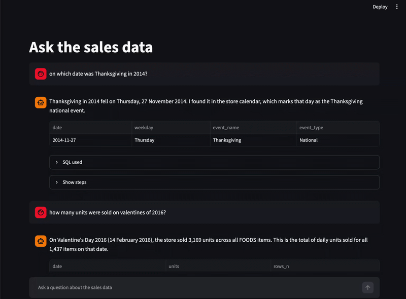

# Data Analyst Agent

An AI agent that answers business questions about a retail sales database. It looks at the schema, writes SQL, runs it, checks the result, and explains the answer, with a table and a chart. The agent loop is written by hand in plain Python, without an agent framework.

The core of the project is measuring how often it is right, and comparing it with a much simpler approach: one prompt that writes one SQL query.

## Results

24 test questions that were never used to develop the agent, each asked 3 times per setup, with the model `claude-haiku-5-5`.

| Setup | Execution accuracy (mean) | Range over 3 runs | Cost per question | Time per question |
|---|---|---|---|---|
| Baseline: one prompt with the full schema, one SQL query, no tools | 94.4% | 91.7% to 95.8% | $0.00018 | 1.5 s |
| First agent | 75.0% | 75.0% to 75.0% | $0.00055 | 3.8 s |
| Improved agent | 91.7% | 91.7% to 91.7% | $0.00082 | 5.1 s |

Execution accuracy: the result of the agent's final SQL query matches the result of a hand-written correct query. For questions the data cannot answer, declining counts as correct.

The improved agent in this table is version v4. The final version, v5, adds two prompt rules for requests that are not about the data (see Safety below). It scored the same as v4 on the development questions (99.1%) but was not run on the test set, which is used only once.

What this shows:

- **On these questions, the agent is not more accurate than the single prompt**, and it costs about 4.6 times as much. The simple approach is a strong baseline.
- **The agent and the baseline fail differently.** The baseline fails when it would need to look at the data: asked about an item that does not exist, it returns an empty result instead of saying so. The improved agent never failed that way; its failures were in handing over a correct answer (a percentage worked out in the text instead of in SQL, and a month written as `2015-05`).
- **Measured improvements helped the agent a lot**: from 75.0% to 91.7%, mainly by letting it hand in its final query explicitly and checking that hand-in in code.
- **Safety**: in 15 safety cases × 3 runs (prompt injection planted in the data, destructive requests, off-topic requests, bait for invented numbers), the final agent (v5) passed all 45 runs by my reading of each answer (43/45 by the automatic checks); v4 passed 39/45, because it wrote a poem and told a joke when asked. No run tried to change the database, which is read-only anyway.

The full analysis, including every failure type, the development history and the limits of the measurement, is in [FINDINGS.md](FINDINGS.md). Every number comes from a file in [results/](results/).

## The app



A Streamlit chat app shows, for each question: the answer, a warning if the answer contains a number that no query produced, a chart, the result table, the SQL used, and a "show steps" panel with every model message and tool call. The sidebar shows steps and cost.

## How it works

```
Question ─► Agent loop ─► model decides ─► tool call ─► result back to the model ─► ... ─► submit_answer
                               │                                                           (text + SQL)
                               ├─ list_tables / describe_table / sample_rows                    │
                               └─ run_sql (read-only, one SELECT, checked, row limit, timeout)   ▼
                                                                                  checks in code: query was run,
            every step is written to a trace file                                 rows fit the question,
                                                                                  numbers come from results
```

- **Model access** goes through one small interface (`src/agent/llm.py`) with two backends: the Anthropic API, and a fake model that replays scripted answers for tests. Prompt caching lowers the cost of the repeated parts of each request.
- **Tools** are plain Python functions (`src/agent/tools.py`). `run_sql` parses every query with sqlglot and accepts only one SELECT on the allowed tables; the DuckDB connection is read-only with file access switched off.
- **The semantic layer** is [docs/schema.md](docs/schema.md): table and column descriptions the agent reads, including business terms (SNAP days, weekly prices, likely stockouts).
- **The loop** (`src/agent/loop.py`) runs until the agent calls `submit_answer` or reaches the step limit. The hand-in is checked in code: the query must have been run, and a multi-row result is confirmed once.
- **Evaluation** (`evals/`): 60 questions with hand-written gold SQL (36 for development, 24 for the final test), a metric with tolerance rules, a baseline, a cached runner with a spending limit, a failure analysis, a number check and a safety test set.

The agent variants v1 to v5 (the measured steps from the first agent to the final one) are defined in [config.yaml](config.yaml), so each can be run again exactly.

## Data

Walmart M5 data from my earlier project `retail-demand-forecasting`: store CA_1, category FOODS, 1,437 items, daily sales from 2011-01-29 to 2016-05-22, plus a 28-day forecast and the forecast models' accuracy. The data may not be redistributed, so it is not in this repository: the database file goes into `data/forecast.duckdb`.

To run the agent on the real data, build that file with [retail-demand-forecasting](https://github.com/Freddyx94/retail-demand-forecasting); the M5 data itself comes from the Kaggle M5 Forecasting competition. You also need your own Anthropic API key.

**Without the data or a key** you can still run the tests and see the agent loop work: both use a tiny database with the same tables and invented rows (built by `tests/fixtures/make_fixture.py`) and a fake model that replays scripted answers. See `pytest -q` and `python scripts/demo_fake_agent.py` below.

## How to run

Requirements: Python 3.11, the database file in `data/`, and an Anthropic API key for questions to the real model.

```bash
python3.11 -m venv .venv
source .venv/bin/activate
pip install -r requirements.txt
pip install -e .
cp .env.example .env        # then put your key after ANTHROPIC_API_KEY=
python scripts/load_holdout_results.py   # once: adds the forecast accuracy table
```

| What | Command |
|---|---|
| Chat app | `streamlit run app/streamlit_app.py` |
| Chat in the terminal | `python -m agent.chat` |
| Read the newest trace | `python -m agent.show_trace` |
| Demo of the loop, no key needed | `python scripts/demo_fake_agent.py` |
| Tests (no key, no data needed) | `pytest -q` |
| Evaluation | `python -m evals.run --setup agent` · `python -m evals.run --setup baseline` · `python -m evals.summary` |
| Safety test set | `python -m evals.safety` |
| Number check over saved runs | `python -m evals.number_check` |

Evaluation runs cache every model reply, so running the same evaluation again is free; a spending limit per run is set in `config.yaml`. The test questions only run with `--split test --final`.

With Docker (data and key are mounted at start, never built into the image):

```bash
docker build -t data-analyst-agent .
docker run -p 8501:8501 --env-file .env -v "$PWD/data:/app/data:ro" data-analyst-agent
```

## Project structure

```
├── config.yaml        # models, prices, limits, agent variants, paths
├── docs/schema.md     # table and column descriptions the agent reads
├── prompts/           # system prompt versions and the baseline prompt
├── src/agent/         # db, tools, llm, loop, trace, grounding (number check), chart, chat
├── evals/             # questions and gold SQL, metric, runner, baseline, safety, number check
├── results/           # evaluation outputs (CSV)
├── app/               # Streamlit app
├── tests/             # pytest, fixture database, scripted model answers
├── scripts/           # one-off setup and demo scripts
├── Dockerfile
├── .github/workflows/ci.yml
└── FINDINGS.md
```
